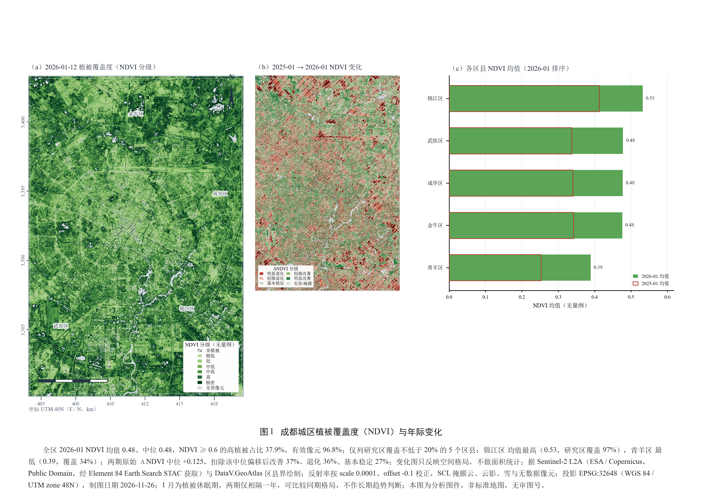

# ndvi-chengdu · 成都主城 NDVI 计算与两期对比

基于 Sentinel-2 L2A 地表反射率，计算成都主城 15.52 × 23.15 km 范围内的 NDVI，做两期同期对比与区县排序，输出 A4 横版专题图（matplotlib 版与 QGIS 版各一套）。



## 1. 结果

| 指标 | 2025-01-03（T1） | 2026-01-12（T2） | 说明 |
|---|---|---|---|
| 全区 NDVI 均值 | 0.354 | 0.481 | 两期同为 1 月，植被休眠期 |
| 全区 NDVI 中位 | 0.329 | 0.483 | |
| NDVI ≥ 0.6 占比（T2） | — | 37.9% | 高植被（林地、菜地、公园） |
| 有效像元占比 | 99.4% | 96.8% | SCL 掩膜与小孔填补后 |
| 水体占比 | 10.5% | 6.6% | 锦江、府河、东风渠等 |

区县统计（T2，按像元面积加权，仅统计与研究区相交的 9 个区县）：锦江区 0.532（最高，区内含三圣乡农区，覆盖 96.9%）；双流区 0.525、新都区 0.482、武侯区 0.478、成华区 0.477、金牛区 0.476、郫都区 0.441、龙泉驿区 0.419；青羊区 0.389（最低，老城硬化地表占比高，覆盖 33.5%）。

两期差值（ΔNDVI）：原始中位 +0.125、均值 +0.135，70.6% 像元为正值。两期红光反射率全区均值为 0.032（T1）与 0.023（T2），200 × 200 分块标准差 0.043、块内最小值仍为 +0.045，判断为成像条件整体差异而非植被变化。扣除全区中位偏移后为改善 37.0%、退化 36.0%、基本稳定 27.0%，5—95 分位区间 [−0.276, 0.319]。

两期相隔一年且同为 1 月，可比较空间格局；全区均值上升主要来自成像条件差异，不作植被恢复的判据。

## 2. 运行

依赖 Python 3.12 与 GDAL 3.x。栅格脚本用 Anaconda 的 python，QGIS 版用 QGIS 自带 python。

```powershell
pip install -r requirements.txt      # affine==2.3.0 为硬约束，见 docs/遥感踩坑速查.md

python search_stac.py       # 1) 检索候选时相、选景 → data/scenes.json
python fetch_ndvi.py        # 2) 按 bbox 取窗、拼幅、反射率校正、掩膜、算 NDVI → data/ndvi_T1.tif / T2.tif
python ndvi_change.py       # 3) 两期差值 + 中位偏移校正 → data/ndvi_delta_norm.tif
python ndvi_stats.py        # 4) 区县统计 → data/ndvi_by_district.csv
python ndvi_map.py          # 5) matplotlib 版 A4 图 → ndvi_map.png / .svg / _gray.png

$env:QT_QPA_PLATFORM="offscreen"; $env:QT_QPA_FONTDIR="C:\Windows\Fonts"
& 'C:\Program Files\QGIS 3.44.15\bin\python-qgis-ltr.bat' qgis_ndvi_layout.py   # 6) QGIS 版布局
```

`fetch_ndvi.py` 只下载研究区窗口（1 552 × 2 315 像元），不下载整景 169 MB；整景下载在本机实测超时，见 `docs/遥感踩坑速查.md` 第 3 条。单景取窗约 4—5 分钟。

`geoenv.py` 负责环境变量修补，须在任何 rasterio 导入之前 import。本机 `PROJ_LIB` 曾指向 PostgreSQL 的 proj 目录，导致所有 EPSG 查询报 `Cannot find proj.db`。

## 3. 计算口径

| 项 | 取值 |
|---|---|
| 数据 | Sentinel-2 L2A（地表反射率），10 m；SCL 20 m |
| 时相 | 2025-01-03（S2B_48RVU + S2B_48RVV）、2026-01-12（S2A_48RVU + S2A_48RVV），云量 0.1% 与 0.3% |
| 研究区 | 104.00—104.16°E / 30.55—30.76°N，UTM 48N，extent (404 090, 3 380 160, 419 610, 3 403 310) |
| 指数 | NDVI = (B08 − B04) / (B08 + B04) |
| 反射率 | DN × 0.0001 + (−0.1)（BOA_ADD_OFFSET）；省略 −0.1 会使 NDVI 系统性偏高 |
| 掩膜 | SCL ∈ {0,1,3,8,9,10,11} 剔除（云、云影、雪、无数据、饱和）；水体不掩膜，保留负值 |
| 小孔填补 | `valid &= red_r>0.002 & nir_r>0.002 & denom>0.002`，再用 `distance_transform_edt` 以 2.5 px 半径补孤立小孔 |
| 变化 | 逐像元 ΔNDVI，扣除全区中位偏移（−0.1246），中位归零后分档 |
| 分级 | NDVI 分七档（−0.2, 0, 0.2, 0.4, 0.6, 0.8）；ΔNDVI 分五档（−0.15, −0.05, 0.05, 0.15） |

有效像元判据未采用 `denom > 0.02`：BOA 偏移 −0.1 会使深色像元的分母趋零，改用 `denom>0.05` 后 |NDVI|>0.95 的极值像元占比由 0.3% 升至 12%。最终口径见上表，`fetch_ndvi.py` 中有对应注释。

## 4. 目录结构

```
ndvi-chengdu/
├─ config.py                 # 路径、bbox、CRS、分级、配色、字体，项目内唯一样式源
├─ geoenv.py                 # PROJ_LIB 修补与 COG 环境变量，须先 import
├─ search_stac.py            # STAC 选景
├─ fetch_ndvi.py             # 取窗、拼幅、掩膜、NDVI 计算与小孔填补
├─ ndvi_change.py            # 两期差值计算与偏移校正
├─ ndvi_stats.py             # 区县统计（以 utf-8-sig 读界线）
├─ ndvi_map.py               # matplotlib 版 A4 横版三合一图
├─ qgis_ndvi_layout.py       # QGIS 版打印布局（PDF / PNG / SVG）
├─ carto.py                  # 图面构件：比例尺、指北针、图廓注记、避让、对比度校验
├─ data/                     # scenes、quality、tif 与区县 csv（本地生成，大文件已 gitignore）
├─ docs/                     # 踩坑速查、数据质量报告、来源与许可、图面自检清单
└─ ndvi_map.png / .svg / ndvi_layout.pdf 等
```

## 5. 数据来源与许可

- Sentinel-2 L2A：ESA / Copernicus，Public Domain。经 Element 84 Earth Search STAC 检索，通过 AWS Open Data 的 COG 直读。
- 成都区县界线：DataV.GeoAtlas（阿里），仅作空间参照，非法定界线，不可用于权属认定。
- 代码 MIT，图件 CC BY 4.0。引用格式：`ndvi-chengdu, 2026, Sentinel-2 L2A NDVI of Chengdu urban area, GitHub`。
- 本图无审图号，属分析图件；公开发布须按《地图管理条例》送审。

## 6. 局限

1. 仅两个时相且相隔一年、同为 1 月（植被休眠期），可比较同期空间格局，不足以判断年际趋势。
2. 变化图只表达空间格局，不做面积统计；ΔNDVI 分档为相对阈值，非生态学阈值。
3. 区县均值按 10 m 像元面积加权，边界外像元按区内面积比例计入；青羊区覆盖率 33.5%，代表性有限。
4. SCL 为 sen2cor 粗分类（T2 有 93% 像元被判为 bare），仅用于剔除云、云影与雪，不参与地类判断。
5. 10 m 像元对应 100 m² 最小制图单元，小于一个像元的绿地（行道树、小区绿化）无法体现。

## English

A Sentinel-2 L2A workflow that computes NDVI over a 15.52 × 23.15 km window of Chengdu's main urban area, compares two January scenes one year apart, ranks 9 districts by area-weighted mean NDVI, and renders an A4 landscape map in both matplotlib and QGIS.

Scene mean NDVI 0.354 (2025-01-03) and 0.481 (2026-01-12); 37.9% of pixels ≥ 0.6 in 2026; Jinjiang highest (0.532), Qingyang lowest (0.389). The raw ΔNDVI median of +0.125 follows from a scene-wide reflectance offset (red band mean 0.032 vs 0.023); after median-offset correction the split is 37% improved, 36% degraded, 27% stable.

Run `pip install -r requirements.txt` (note `affine==2.3.0`), then `search_stac.py → fetch_ndvi.py → ndvi_change.py → ndvi_stats.py → ndvi_map.py`. Only the AOI window is downloaded (about 1 552 × 2 315 px per scene).

NDVI = (B08 − B04)/(B08 + B04) on BOA-corrected reflectance (scale 0.0001, offset −0.1), with SCL masking of cloud, shadow, snow and nodata, 2.5 px hole filling, and median-offset correction for the inter-scene difference.

Code MIT, figures CC BY 4.0. Imagery: ESA Copernicus Sentinel-2, public domain, retrieved via Element 84 Earth Search STAC. District boundaries from DataV.GeoAtlas are a spatial reference only, not an official delimitation. This map carries no Chinese map-approval number (审图号) and must be submitted for review before public release.

Two winter scenes only, so the comparison describes spatial pattern rather than trend; ΔNDVI classes are relative, not ecological thresholds.
